[dsd2pcm-rs](../README.md) › [Documentation](README.md) › PCM quality

# PCM quality

How good dsd2pcm's DSD64 to PCM conversion is, measured, and why it is built the way it is.
Every number on this page comes from the scripts in [tools/quality](../tools/quality/README.md)
and can be reproduced with the commands at the end.

## Summary

From 0.2.0 the default filter is `precise`. `fast` is scarletbook-pcm 0.7.0's filter (the
default up to 0.1.2): byte-identical with scarletbook-pcm, lower CPU time and lower quality.
The two side by side, from the [precise filter](#the-precise-filter) section below:

| | `precise` (default) | `fast` |
|---|---|---|
| SINAD, 1 kHz at 0 dB SACD, very quiet DSD64 source (the source itself: 146.9 dB) | 141.8 dB (88.2 kHz), 143.6 dB (176.4 kHz), 144.9 dB (352.8 kHz); `wide` 143.6 / 144.8 dB | 122.0 to 122.1 dB; `wide` 116.1 dB |
| Alias rejection, worst band that folds onto 0-20 kHz, from the taps | 158.0 dB; `wide` 151.3 dB | 111.5 to 114.5 dB; `wide` 111.0 to 111.1 dB |
| Alias rejection, measured: 11 loud tones at 333-1078 kHz, worst | 157.5 dB; `wide` 151.0 dB | 114.5 dB; `wide` 111.2 dB |
| Stopband | 157.8 dB; `wide` 151.3 dB | 109.7 to 111.1 dB |
| Passband ripple to 20 kHz | ±0.0016 to ±0.0022 dB | ±0.0037 to ±0.0040 dB |
| Ringing above -60 dB, each side of an impulse (40 kHz) | 0.30 ms | 0.26 ms |
| CPU time against scarletbook-pcm 0.7.0 (Intel Core i9-13900H, [performance](performance.md#precise-and-fast-against-scarletbook-pcm-070)) | 1.30 to 1.91 times | 0.80 to 0.90 times |
| Output | deterministic within a release | the same bytes as scarletbook-pcm 0.7.0 |

Measured with (this table): dsd2pcm at commit `e5871b4` for `precise` and `fast`,
and the scripts in [tools/quality](../tools/quality/README.md) at the same commit
(dsd-measure is not used on this page; it runs the [release comparison](quality/README.md));
the full set of versions and the host CPU is under [reproducing](#reproducing-the-measurements).
CPU time: Intel Core i9-13900H.

With the 5th-order test signals below, both are limited by the test signal: `precise`
measures the source's noise (-122.5 dBFS), `fast` -121.9 dBFS (-118.8 dBFS with `wide`). Unless a
section says otherwise, the figures from here to the precise filter section are `fast`'s,
measured on DSD64 test signals and from the filters' exact taps. "Source" is the test DSD
itself, analysed as a bitstream: the reference each converter's figures are set against.

| | 30 kHz filter | 40 kHz filter (default) | wide filter |
|---|---|---|---|
| Passband ripple to 20 kHz | ±0.0037 dB | ±0.0039 dB | ±0.0039 dB (±0.0040 dB at 352.8 kHz) |
| -3 dB point | 32.0 kHz | 42.7 kHz | 82.7 kHz (176.4 kHz), 85.3 kHz (352.8 kHz) |
| Stopband | 110.2 dB from 36 kHz | 110.9 dB from 48 kHz | 109.7 dB from 88.2 kHz (176.4 kHz), 111.1 dB from 96 kHz (352.8 kHz) |
| Phase | linear, no delay | linear, no delay | linear, no delay |
| Ringing above -60 dB, each side of an impulse | 0.35 ms | 0.26 ms | 0.23 ms (176.4 kHz), 0.13 ms (352.8 kHz) |
| THD+N, 1 kHz at 0 dB SACD (source: -106.1 dB) | -106.0 dB | -105.9 to -106.0 dB | -105.5 to -105.6 dB |
| Noise, 20 Hz-20 kHz (source: -122.5 dBFS) | -121.9 dBFS | -121.9 dBFS | -118.8 dBFS |
| Ultrasonic noise passed, 20 kHz to Nyquist (source: -46.0 dBFS in 20-100 kHz) | -88.3 dBFS | -70.2 dBFS | -51.0 dBFS (176.4 kHz), -50.2 dBFS (352.8 kHz) |
| Gain at 1 kHz | +0.0034 dB | -0.0026 dB | +0.0028 dB (176.4 kHz), -0.0009 dB (352.8 kHz) |

At every rate and filter:

- **`fast` is byte-identical with scarletbook-pcm 0.7.0**: 272 of 272 test outputs have the same samples.
- **DSD silence converts to exact digital zero**; the polarity is preserved; identical channels give identical samples.
- **No clipping at 0 dB gain** up to +4.5 dB SACD, past the +3.1 dB SACD peak level the Scarlet Book allows.
- **24-bit output, rounded, not dithered.** The rounding noise (-153 dBFS in 20 Hz-20 kHz at 176.4 kHz) is 30 dB below the DSD64 test signal's own noise.
- **Filter floor:** with a very quiet DSD64 source the filters themselves limit the audio band to about -128 dBFS (-122 dBFS with `wide`): a stopband limit, measured and explained [below](#filter-floor-with-very-quiet-sources).
- **The precise filter**, the default from 0.2.0, removes that floor: 150 dB and more of stopband wherever content folds into the passband, SINAD 142 to 145 dB with that source (the 24-bit output's limit), about half the passband ripple, at about twice the CPU time ([details](#the-precise-filter)).
- **Against the foobar2000 SACD plug-in** (2.0.27): equal in the audio band within 0.6 dB, the plug-in slightly quieter; dsd2pcm keeps DSD silence and timing exact and passes -70.2 dBFS of ultrasonic noise above 20 kHz at 352.8 kHz, against -35.1 dBFS from the plug-in's default mode ([details](#comparisons)).

With the 5th-order test signals the figures are limited by the test signal, not by the converter: THD+N, noise and
dynamic range are within 0.1 to 0.6 dB of what the DSD itself contains, except the wide
filter's in-band noise (3 dB higher; see [bandwidth](#bandwidth-and-ultrasonic-noise)). The
`fast` filter figures match the published response of scarletbook-pcm 0.7.0 exactly.

## How it was measured

Two methods, which agree:

1. **The filter itself.** The exact integer taps in
   [`tables.rs`](../crates/dsd2pcm/src/decimator/tables.rs) are chained into the one
   composite filter that the stages make together, and its response is computed
   (`filters.py`). This gives ripple, stopband, aliasing and ringing with no measurement
   noise at all.
2. **End to end.** Synthetic test signals are encoded to DSD64, converted by the real
   `dsd2pcm` command and analysed from the WAV files (`gen_signals.py`, `decode.py`,
   `analyse.py`). This covers what the taps cannot show: the 24-bit rounding, the gain,
   clipping, polarity and the handling of real modulator noise.

The DSD itself is also analysed directly, as a bitstream, so each result can be set against
what the source contained. Where a figure is limited by the test signal rather than by the
converter, this page says so.

Measured with, unless a section says otherwise: dsd2pcm `fast` at commit `172eb97`, the
scripts in tools/quality at that commit, on Linux x86_64 with an AMD Ryzen AI MAX+ 395
(the full list is under [reproducing](#reproducing-the-measurements)); dsd-measure is not used
on this page.

**The test signals.** The set follows what reviewers publish, so results can be compared
like for like. The method follows the DSD-to-PCM comparison of
[Archimago](https://archimago.blogspot.com/)
([2015](https://archimago.blogspot.com/2015/04/analysis-dsd-to-pcm-2015-foobar-sacd.html)),
his DSD test signals and level rules
([2021](https://archimago.blogspot.com/2021/10/measurements-look-at-dsd-and-using-sox.html),
[2022](https://archimago.blogspot.com/2022/06/notes-on-dac-dsd-1-bit-pdm-measurements.html)),
the [RightMark Audio Analyzer](http://audio.rightmark.org/) (RMAA) summary, and AES17 for
the measurement bandwidth (20 Hz to 20 kHz). The noise and dynamic range figures are
AES17-style, not AES17: the deviations are [listed below](#aes17-style-not-aes17). The
measurement practice of [Audio Science Review](https://www.audiosciencereview.com/) and of
John Atkinson at [Stereophile](https://www.stereophile.com/content/measurements-maps-precision)
(multitone, J-Test, linearity, raw-sample impulse plots) was the reference for the
remaining tests. No RMAA or other closed tool is
used: the analysis is our own script, and every setting is written into its output.
The definitions are in [`signals.toml`](../tools/quality/signals.toml).

- **PCM test signals** at 24/88.2 and 24/96 (TPDF-dithered, fixed seed) are interpolated
  to the DSD rate (a linear-phase filter with a 120 dB stopband) and encoded by the
  reference modulator.
- **The reference modulator** (`modulator.py`) is a 5th-order 1-bit sigma-delta modulator
  in error-feedback form, so it passes the signal unchanged (its signal transfer function is
  exactly 1). Its noise transfer function has zeros at DC, 10.8 and 18.1 kHz and
  Butterworth poles; the largest noise gain is 1.3, which keeps it stable up to at least
  +3.5 dB SACD, past the +3.1 dB SACD peak level (Schreier and Temes, *Understanding
  Delta-Sigma Data Converters*, 2005, chapters 4.3 and 4.4). SACD encoders are of this
  class, usually with look-ahead (E. Janssen, *Look-ahead sigma-delta modulation and its
  application to Super Audio CD*, TU Eindhoven, 2010). This one is plain and deterministic,
  and its noise is higher than a good mastering encoder's: about -106 dB THD+N at 0 dB SACD.
- **SoX-DSD** (Måns Rullgård's DSD branch of SoX, run as a separate program) encodes
  three of the signals a second time, with the 8th-order CLANS modulator and trellis
  search that Archimago used (`sdm -f clans-8 -t 32 -n 32`).
- **Bit patterns** without a modulator: the SACD silence pattern (`0x69`), one flipped
  bit in that silence (the filter's own impulse response) and a step from silence to a
  pattern at 50 % modulation.

| Signal | Definition | Used for |
|---|---|---|
| `silence` | 24-bit TPDF-dithered digital silence, 15 s | noise level, ultrasonic noise, DC |
| `idle` | the SACD silence pattern `0x69` | digital silence |
| `sine1k_0` | 1 kHz at 0 dB SACD (-6.02 dBFS), 10 s | THD, THD+N, gain, channel matching |
| `sine1k_peak` | 1 kHz at +3.1 dB SACD (-2.92 dBFS) after 3 s of silence and a 2 s ramp | headroom ([Archimago 2022](https://archimago.blogspot.com/2022/06/notes-on-dac-dsd-1-bit-pdm-measurements.html)) |
| `level_steps` | 1 kHz from -3 to -126 dBFS in 3 dB steps | THD+N against level, linearity, dynamic range (-60 dB SACD step) |
| `freq_steps` | 20 Hz to 20 kHz at 0 dB SACD | THD+N against frequency |
| `smpte`, `ccif` | 60 Hz + 7 kHz (4:1), 19 + 20 kHz (1:1), peak 0 dB SACD | intermodulation |
| `fr_tones` | 35 tones, 20 Hz to 40 kHz, -40 dBFS each | frequency response |
| `xtalk_l`, `xtalk_r` | 100 Hz, 1, 10, 20 kHz in one channel, silence in the other | crosstalk |
| `multitone` | 32 tones, 17.6 Hz to 21.4 kHz, peak 0 dB SACD (crest factor 13.2 dB), after silence and a ramp | distortion-free range ([Archimago 2021](https://archimago.blogspot.com/2021/10/measurements-look-at-dsd-and-using-sox.html)) |
| `jtest` | 24-bit J-Test: fs/4 at -3 dBFS and a 1-LSB square at fs/192, after silence and a ramp | arithmetic artefacts ([Archimago 2021](https://archimago.blogspot.com/2021/10/measurements-look-at-dsd-and-using-sox.html)) |
| `sine15k` | 15 kHz at -12 dBFS | time-domain view ([Archimago 2015](https://archimago.blogspot.com/2015/04/analysis-dsd-to-pcm-2015-foobar-sacd.html)) |
| `impulse`, `step`, `polarity` | one 0 dB SACD sample, a step, a positive half-sine pulse | ringing, polarity |
| `alias_steps` | 50 to 200 kHz at -20 dB SACD, defined at the DSD rate | aliasing |
| `hot_ramp` | 1 kHz rising from -12 to -1.5 dBFS (+4.5 dB SACD) | clipping and headroom |
| `bit_impulse`, `bit_step` | one flipped bit in `0x69`; `0x69` then `0xEE` (0 dB SACD) | the filter's exact impulse and step response |

Most signals exist as DSD64, DSD128 and DSD256. dsd2pcm and the pysacd preset convert
DSD64 only, so the DSD128 and DSD256 versions serve the other decoders and the source
analysis. Analysis settings (in `analyse.py` and in every results file): a 7-term
Blackman-Harris window, 2^18-point FFTs for tones (2^20 for the multitone, rectangular, as
its tones sit exactly on bins), Welch averaging of 8 for noise, the first 0.5 s of every
steady part skipped, and tones moved to exact FFT bins (multiples of 352 800 / 2^18 Hz).

### AES17-style, not AES17

The method takes two things from AES17 (*AES standard method for digital audio
engineering: measurement of digital audio equipment*, AES17-2020): the 20 Hz to 20 kHz
measurement band and levels in dBFS relative to a full-scale sine. Nothing on this page is
an AES17 measurement or claims AES17 conformance. What `analyse.py` and `signals.toml` do
differently (clause numbers of AES17-2020):

- **Test tone:** 999.95 Hz (1 kHz moved onto an FFT bin), not 997 Hz.
- **Level:** THD, THD+N and SINAD of a tone at 0 dB SACD, which is -6.02 dBFS in the
  output; AES17 measures THD+N at -1 dB and -20 dB relative to the maximum level
  (clause 6.3.2).
- **Dynamic range:** a 1 kHz step at -60 dB SACD (-66.02 dBFS) in a stepped-level signal,
  the noise and distortion beside it given relative to 0 dB SACD, A-weighted; AES17 uses
  997 Hz at -60 dB relative to the maximum level, the result relative to full scale and
  CCIR-RMS weighted (clause 6.4.1).
- **Weighting:** A-weighting (IEC 61672-1, 0 dB at 1 kHz) for the weighted noise and
  dynamic range figures; the AES17 weighting is CCIR-RMS, the ITU-R BS.468 response
  (clause 5.2.7). All other figures are unweighted.
- **Notch:** no notch filter. The tone is removed by leaving out 8 FFT bins on each side
  of it: ±2.7 Hz at 88.2 kHz, ±5.4 Hz at 176.4 kHz and ±10.8 Hz at 352.8 kHz output
  (±5.4 Hz at every rate for the dynamic range step). AES17's notch has a Q of 1.2 to 3
  (clause 5.2.8) and so also removes the energy close to the tone, which counts here.
- **Band limit:** a brick-wall sum of FFT bins from 20 Hz to 20 kHz, not AES17's standard
  low-pass filter (clause 5.2.5).
- **Averaging:** tones from a single 2^18-point FFT (7-term Blackman-Harris window), no
  averaging; noise from Welch averaging of 8 records with 50 % overlap.
- **Stimulus:** the device's input is DSD64 from a test modulator, not PCM dithered at the
  input word length (clause 5.1.3); the modulator's noise is in every figure, so the
  source's own figures stand beside the converter's in every table.

## Levels and headroom

dsd2pcm maps 100 % DSD modulation (a stream of all ones) to 24-bit full scale at 0 dB
gain: between stages samples live on a grid where 100 % is 2^26, and the quantiser scales
that by 1/8 to 2^23 and rounds. So, with the Scarlet Book's levels (as
[Archimago restates them, 2022](https://archimago.blogspot.com/2022/06/notes-on-dac-dsd-1-bit-pdm-measurements.html)):

| DSD level | Modulation | dsd2pcm output, gain 0 dB | With `--gain +6` |
|---|---:|---:|---:|
| 0 dB SACD, the reference level | 50 % | -6.02 dBFS | 0.0 dBFS |
| +3.1 dB SACD, the peak level allowed | 71.43 % | -2.92 dBFS | clips (+3.1 dBFS) |
| +7 dB SACD, reported on some hot masters | (above the limit) | +1.0 dBFS: clips | clips |
| 100 % | 100 % | 0 dBFS (clamped to +8 388 607 and counted) | clips |

- **The default keeps 2.9 dB of headroom above the peak level.** Every disc that follows
  the Scarlet Book converts without clipping at 0 dB gain.
- **Inter-sample peaks.** A DAC's reconstruction filter can make peaks between samples that
  are higher than the samples. At 0 dB gain a tone at the peak level gave samples of
  -2.1 dBFS at most with the 40 kHz filter and -1.7 dBFS with the wide filter (see below),
  which leaves room for them. Raising `--gain` uses that room up.
- **Clipping is clamped and counted, never wrapped.** The command prints the number of
  clipped samples, in all and per channel; the library reports them per frame. A clipped
  sample is ordinary digital clipping: the peak is flattened at full scale, which adds
  distortion products while it lasts.
  If a disc clips, convert it again with a lower `--gain` (for example `--gain -3`).

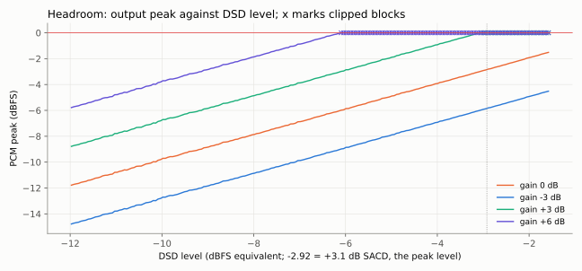

*A 1 kHz tone rising to +4.5 dB SACD, converted at 176.4 kHz with the 40 kHz filter: the
output peak follows the DSD level 1:1. At 0 dB gain nothing clips; at +3 dB gain clipping
starts at -3.0 dBFS DSD level (+3.0 dB SACD), at +6 dB gain at -6.1 dBFS (0 dB SACD).*

The output's peaks also carry the DSD's ultrasonic noise that the filter passes. A +3.1 dB
SACD tone (-2.92 dBFS) gave sample peaks of -2.9 dBFS at 88.2 kHz, -2.1 dBFS with the
40 kHz filter at 176.4 and 352.8 kHz, and -1.7 dBFS with the wide filter at 352.8 kHz:
still inside the headroom, but the wide filter uses up more of it.

## Filter character

All filters are **linear phase** (symmetric taps: every frequency is delayed equally, so
the waveform's shape is kept), **not apodizing** (they do not roll off before the band edge
to suppress pre-ringing), and **steep**: Parks-McClellan equiripple designs with about
110 dB of stopband. The output is centred: sample *n* is centred on DSD sample 32*n*, 16*n*
or 8*n*, so there is no delay to compensate and no offset between files converted at
different rates.

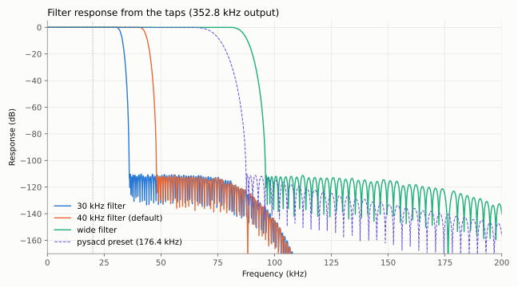

*The three filters at 352.8 kHz output: flat to the passband edge, then down by 110 dB or
more. The 20 kHz line marks the top of the audio band.*

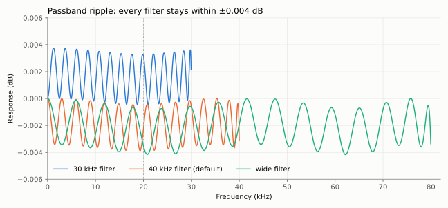

*Zoomed to ±0.006 dB: the ripple of every filter stays within ±0.004 dB.*

The filters' exact response, from their taps (the pysacd preset in the last two rows):

| Rate (kHz) | Filter | Ripple to 20 kHz (dB) | Ripple to the passband edge (dB) | -3 dB (kHz) | Stopband (dB) | Worst alias into 0-20 kHz (dB) | Images (dB) | Ringing above -60 dB, each side (ms) | Step overshoot (%) | Delay |
|---:|---|---:|---:|---:|---:|---:|---:|---:|---:|---|
| 88.2 | 30 kHz | ±0.0037 | ±0.0037 (to 30 kHz) | 32.0 | 110.2 (from 36 kHz) | 111.5 | – | 0.348 | 8.9 | none (centred) |
| 88.2 | 40 kHz | ±0.0039 | ±0.0039 (to 40 kHz) | 42.7 | 110.9 (from 48 kHz) | 111.9 | – | 0.261 | 8.9 | none (centred) |
| 176.4 | 30 kHz | ±0.0037 | ±0.0037 (to 30 kHz) | 32.0 | 110.2 (from 36 kHz) | 114.5 | – | 0.348 | 8.9 | none (centred) |
| 176.4 | 40 kHz | ±0.0039 | ±0.0039 (to 40 kHz) | 42.7 | 110.9 (from 48 kHz) | 114.5 | – | 0.261 | 8.9 | none (centred) |
| 176.4 | wide | ±0.0039 | ±0.0039 (to 80 kHz) | 82.7 | 109.7 (from 88.2 kHz) | 111.0 | – | 0.231 | 8.9 | none (centred) |
| 352.8 | 30 kHz | ±0.0037 | ±0.0037 (to 30 kHz) | 32.0 | 110.2 (from 36 kHz) | 114.5 | 119.3 | 0.348 | 8.9 | none (centred) |
| 352.8 | 40 kHz | ±0.0039 | ±0.0039 (to 40 kHz) | 42.7 | 110.9 (from 48 kHz) | 114.5 | 119.3 | 0.261 | 8.9 | none (centred) |
| 352.8 | wide | ±0.0040 | ±0.0042 (to 80 kHz) | 85.3 | 111.1 (from 96 kHz) | 111.1 | – | 0.130 | 8.9 | none (centred) |
| 88.2 | pysacd preset | ±0.0001 | ±0.0001 (to 40 kHz) | 43.4 | 109.8 (from 48 kHz) | 114.7 | – | 0.291 | 8.9 | removed (centred) |
| 176.4 | pysacd preset | ±0.0001 | ±0.0002 (to 60 kHz) | 71.9 | 111.2 (from 88.2 kHz) | 114.7 | – | 0.092 | 8.8 | removed (centred) |

"Ringing" is the time the impulse response stays above -60 dB (a thousandth) of its peak,
before and after it; linear phase makes the two equal. The 352.8 kHz output of the 30 and
40 kHz filters is interpolated from 176.4 kHz; "images" is how far the interpolation's
images are suppressed.

**Pre-ringing, and what it means here.** A linear-phase filter rings symmetrically: the
impulse response below has as many ripples before the main sample as after it. The
ringing is at the transition band (about 43 kHz for the 40 kHz filter, 32 kHz for the
30 kHz one, 83 to 85 kHz for wide), so it is ultrasonic, and it lasts about a quarter of a
millisecond above -60 dB. It is only excited by content in that transition band; on
DSD64 that content is the modulator's noise, not music. Music that ends well below the
cutoff passes with no ringing added.

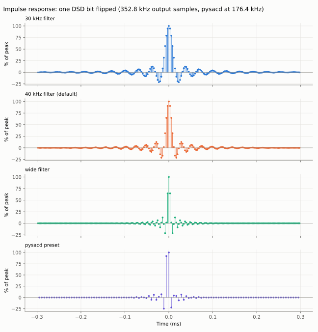

*One DSD bit flipped in silence, as converted: the actual 352.8 kHz output samples, drawn
as stems with nothing interpolated between them. Positive, symmetric and centred on its
sample.*

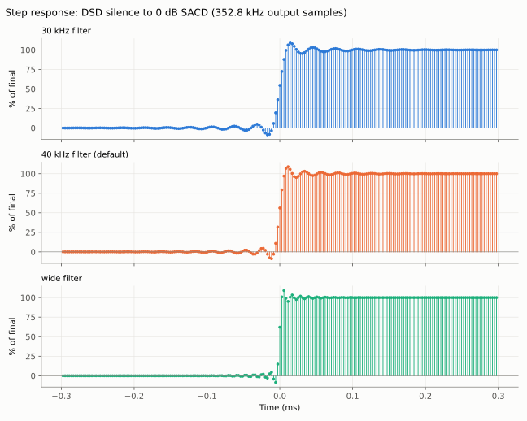

*A step from DSD silence to 0 dB SACD. The overshoot (about 9 %) is the Gibbs ringing every
steep linear-phase low-pass has; it mirrors before the step.*

**Options offered, and not.**

| Option | Offered | Why |
|---|---|---|
| 40 kHz passband, 48 kHz stopband (default) | yes | Flat to 40 kHz, twice the 20 kHz top of the audio band; removes DSD64's noise from 48 kHz up, where it rises steeply. The Scarlet Book recommends a low-pass around 50 kHz for DSD64 playback (Annex D, as cited by Archimago, 2022). |
| 30 kHz passband, 36 kHz stopband | yes | Less of DSD64's ultrasonic noise in the file (-88.3 against -70.2 dBFS above 20 kHz), for playback chains that should receive less ultrasonic content. |
| wide: 80 kHz passband (176.4 and 352.8 kHz) | yes | Keeps everything a DSD64 stream holds to 80 kHz, for listeners who want the ultrasonic band. It follows the Philips blind tests cited in [sacdfs's filter decision](https://github.com/dsd-toolbox/sacdfs/blob/main/docs/pcm-quality.md#the-filters), which report 80 to 100 kHz filters as not detected by their listeners and a 50 kHz one as detected. That is the cited source's listening result; no listening test was made here. 40 kHz stays the default. |
| `fast` | yes | scarletbook-pcm 0.7.0's filter, byte-identical with it: lower CPU time, about 110 dB of stopband. The default up to 0.1.2. |
| pysacd preset | yes | pysacd's own filter and dithered quantiser, computed in `f64`, for output with pysacd's response. |
| minimum phase, apodizing, "slow" roll-off | no | They trade passband phase or treble response for less pre-ringing, which here is at the transition band (32 to 85 kHz) and excited only by content there (see the questions at the end). |
| dither | no | See [resolution](#resolution-noise-dynamic-range-rounding). |

## Bandwidth and ultrasonic noise

DSD64 moves its quantisation noise above 20 kHz, where it rises steeply: in the test signal
(modulated silence) the noise from 20 to 100 kHz adds up to -46 dBFS, and it keeps rising to
several hundred kHz. Each filter decides how much of it reaches the PCM file:

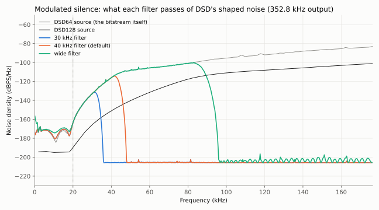

*Noise density of modulated silence at 352.8 kHz output. The grey line is the DSD64 test
signal itself, the black line the same signal as DSD128. The 30 and 40 kHz filters cut it
at 36 and 48 kHz; the wide filter keeps it to 96 kHz.*

| Band | DSD64 source | 30 kHz filter | 40 kHz filter | wide filter | DSD128 source | DSD256 source |
|---|---:|---:|---:|---:|---:|---:|
| 20-40 kHz | -74.3 dBFS | -88.3 dBFS | -74.3 dBFS | -74.3 dBFS | -109.0 dBFS | -138.5 dBFS |
| 40-96 kHz | -47.1 dBFS | -150.9 dBFS | -72.2 dBFS | -50.2 dBFS | -64.1 dBFS | -97.2 dBFS |
| 96-144 kHz | -37.0 dBFS | -151.8 dBFS | -151.8 dBFS | -149.5 dBFS | -53.8 dBFS | -76.9 dBFS |

(352.8 kHz output; the source columns are the bitstreams themselves.)

- **What "wide" lets through.** With DSD64, almost everything it keeps above 40 kHz is the
  modulator's noise, at -50 dBFS: about 45 dB below a 0 dB SACD tone. The 40 kHz default
  keeps it out of the file (-72.2 dBFS in 40-96 kHz) for playback chains that should not
  receive it. With DSD128 or
  DSD256 sources the 40-96 kHz band is 17 to 50 dB quieter, which is where a wide filter
  starts to make sense; dsd2pcm does not convert those rates yet.
- **The wide filter's in-band noise is 3 dB higher** (-118.8 against -121.9 dBFS). This is
  aliasing of the DSD's strong noise between 300 and 400 kHz: the wide filter's first stage
  stops from 256.8 kHz instead of 304.8 kHz, so it attenuates that band by 111 dB rather
  than 116 dB, and with this modulator the folded noise reaches about -121 dBFS in the
  audio band. It is still more than 20 dB below the noise of 16-bit audio, but it is the one figure where the wide filter is measurably worse.
- **The 30 and 40 kHz filters' in-band noise** is 0.6 dB above the source. The difference,
  about -131 dBFS, is also folded ultrasonic content; most of it comes from an idle tone of
  the test modulator at a quarter of the DSD rate (705.6 kHz), which every output rate folds
  to near 0 Hz, where it shows as the raised floor below 1 kHz in the plot below. It is
  a property of the 110 dB stopband and of the test signal, not of the arithmetic: the
  24-bit rounding alone is at -153 dBFS.

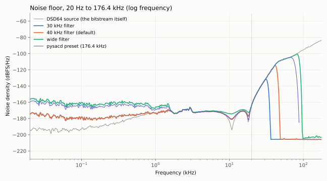

**Aliasing, end to end.** Tones at 50 to 200 kHz (-20 dB SACD each) were converted at every
setting. No alias was found above the DSD's own content at the frequency where an alias
would land: at 176.4 kHz with the 40 kHz filter, the tones at 50, 60 and 80 kHz were
rejected by 113 to 117 dB, and at higher frequencies the output was at or below the test
signal's own noise there. The tap-based figures above (110 dB or more) are the aliasing
specification.

## Resolution: noise, dynamic range, rounding

- **The noise floor is the DSD's, not the converter's.** In 20 Hz to 20 kHz the output of
  modulated silence is -121.9 dBFS (-123.8 dB(A)); the test DSD itself has -122.5 dBFS.
  Relative to 0 dB SACD that is a noise level of -117.8 dB(A), and the dynamic range by an
  AES17-style method (a -60 dB SACD tone; [deviations](#aes17-style-not-aes17)) is
  107.0 dB(A), against 107.1 dB(A) in the source. A
  good SACD master has a lower floor than this test modulator; the converter's own floor is
  about -128 dBFS ([filter floor](#filter-floor-with-very-quiet-sources)) and the rounding's
  -153 dBFS.
- **24-bit rounding is 30 dB below this test signal's noise.** The rounding to 24 bits adds
  -146 dBFS of noise over the whole band at 176.4 kHz, -153 dBFS of it in 20 Hz-20 kHz: 30 dB
  below the source's noise. With a much quieter source it sets the floor of the precise
  filter ([limits](#the-precise-filter)).
- **Rounding, not truncation.** Every stage rounds half to even. Truncation would add a
  constant offset of half an LSB (-144 dBFS of DC) and an error correlated with the signal.
  Measured DC on modulated silence: -175 dBFS with the 30 and 40 kHz filters.
- **No dither, and why.** Dither makes rounding error behave like noise when the signal is
  too clean to do that itself. DSD never is: its own noise in the output is hundreds of LSBs
  (the noise above 20 kHz that the 40 kHz filter passes is at -70 dBFS, about 2 000 times
  an LSB), so the rounding error is already random. Dither would add noise (the pysacd
  preset, which dithers, measures 1 dB more in-band noise) and would turn DSD silence, which
  converts to exact zero today, into hiss. And it would make the output depend on a random
  sequence, which would end deterministic output.
- **Low-level linearity.** A 1 kHz tone stepped from -3 to -126 dBFS: the level error of the
  output follows the source's within 0.01 dB at every step with the 30 and 40 kHz filters,
  within 0.05 dB with `wide` (its extra noise, at the lowest levels). The error itself
  (-0.06 dB at -90 and -120 dBFS) is the test modulator's; the source has it too.

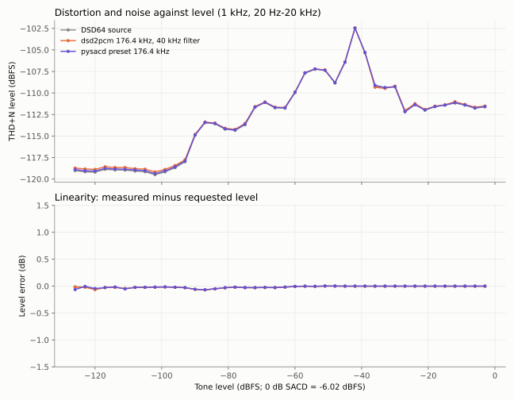

*Top: the noise and distortion level beside a 1 kHz tone, against the tone's level. The
output (orange) lies on the source (grey); the bump around -40 dBFS is the test modulator's
noise modulation. Bottom: measured minus requested level.*

## Determinism, gain, timing and channels

| Property | Result |
|---|---|
| Deterministic output | Within a release, the same input, rate, filter and gain give the same bytes on every CPU, SIMD level, thread count and split of the input. `fast` also gives the same bytes as scarletbook-pcm 0.7.0 (272 of 272 test outputs). |
| Gain | 0 dB SACD (50 % modulation) converts to -6.02 dBFS; the error at 1 kHz is the filter ripple, within ±0.0034 dB. |
| Absolute polarity | Preserved: a bit flipped from 0 to 1 gives a positive output peak, a step up gives a positive step, at every setting. |
| Time alignment | Output sample *n* is centred on DSD sample *dn*; the fitted phase of a 1 kHz tone matches the source's within 0.3 ns. No delay. |
| Channel matching | Each channel goes through the same filter with the same arithmetic: identical channels give identical samples (no level or phase difference at all). |
| Crosstalk | None: channels are converted separately. DSD silence next to a full-level channel converts to exact zero; with modulated silence in the other channel the tone's frequency reads 138 to 172 dB below it, which is that channel's own noise. |
| DC | -175 dBFS on modulated silence (30 and 40 kHz filters), -165 dBFS (wide). |
| Resampling | None beyond the ratio: the rates divide 2.8224 MHz exactly (by 32, 16 and 8). The output has ceil(samples / d) samples per channel. |
| Digital silence | The SACD silence pattern (`0x69`), at the edges of a file too, converts to exactly 0 at every rate, filter and gain. |

## RMAA-style summary

In the layout of [RMAA](http://audio.rightmark.org/)'s summary, as
[Archimago used it in 2015](https://archimago.blogspot.com/2015/04/analysis-dsd-to-pcm-2015-foobar-sacd.html), measured with our own script
(no RMAA). Our conventions, stated exactly: levels relative to 0 dB SACD (RMAA normalises to
its own reference level; ours is 0 dB SACD, -6.02 dBFS); 20 Hz to 20 kHz; noise level is
A-weighted modulated silence; dynamic range is 60 dB plus the A-weighted noise and
distortion beside a -60 dB SACD 1 kHz tone (AES17-style, [deviations](#aes17-style-not-aes17)); THD (harmonics 2 to 9) and THD+N of
1 kHz at 0 dB SACD; IMD SMPTE is 60 Hz and 7 kHz at 4:1 (sidebands to the 4th order); IMD
CCIF is 19 and 20 kHz at 1:1 (difference and 3rd-order products); crosstalk is at 1 kHz,
0 dB SACD; frequency response is the range of 1/3-octave tones relative to 1 kHz. All from
the DSD64 versions of the 24/88.2 test signals. Measured with: dsd2pcm `fast` at commit
`172eb97`, tools/quality at that commit, on an AMD Ryzen AI MAX+ 395 (details under
[reproducing](#reproducing-the-measurements)); dsd-measure not used.

| Decoder and setting | Noise level, dB(A) | Dynamic range, dB(A) | THD, % | THD+N, dB | IMD+N SMPTE, % | IMD CCIF, % | Crosstalk at 1 kHz, dB | Frequency response 20 Hz-20 kHz, dB |
|---|---:|---:|---:|---:|---:|---:|---|---|
| DSD64 source itself (reference) | -118.2 | 107.1 | 0.00023 | -106.1 | 0.00058 | 0.00083 | -162.0 | -0.001, +0.002 |
| dsd2pcm 88.2 kHz, 30 kHz | -117.8 | 107.0 | 0.00022 | -106.0 | 0.00056 | 0.00089 | -161.3 | -0.003, +0.002 |
| dsd2pcm 88.2 kHz, 40 kHz | -117.8 | 107.0 | 0.00022 | -106.0 | 0.00056 | 0.00089 | -162.3 | -0.002, +0.003 |
| dsd2pcm 176.4 kHz, 30 kHz | -117.8 | 107.0 | 0.00023 | -106.0 | 0.00057 | 0.00084 | -161.1 | -0.003, +0.002 |
| dsd2pcm 176.4 kHz, 40 kHz | -117.8 | 107.0 | 0.00023 | -105.9 | 0.00057 | 0.00084 | -161.5 | -0.002, +0.003 |
| dsd2pcm 176.4 kHz, wide | -115.2 | 106.9 | 0.00022 | -105.5 | 0.00057 | 0.00085 | -159.3 | -0.003, +0.002 |
| dsd2pcm 352.8 kHz, 30 kHz | -117.8 | 107.0 | 0.00023 | -106.0 | 0.00059 | 0.00073 | -161.0 | -0.003, +0.002 |
| dsd2pcm 352.8 kHz, 40 kHz | -117.8 | 107.0 | 0.00023 | -106.0 | 0.00059 | 0.00073 | -161.3 | -0.002, +0.003 |
| dsd2pcm 352.8 kHz, wide | -115.2 | 106.9 | 0.00023 | -105.6 | 0.00059 | 0.00072 | -159.7 | -0.003, +0.001 |
| pysacd preset 88.2 kHz | -116.8 | 107.1 | 0.00022 | -106.1 | 0.00056 | 0.00089 | -159.0 | -0.001, +0.002 |
| pysacd preset 176.4 kHz | -116.8 | 107.0 | 0.00022 | -106.1 | 0.00058 | 0.00083 | -159.1 | -0.001, +0.002 |

- **Every dsd2pcm row is within 0.4 dB of the source row**, except the wide filter's noise
  (explained under [bandwidth](#bandwidth-and-ultrasonic-noise)). The numbers describe the
  test modulator; the converter changes them by 0.4 dB or less.
- **Crosstalk** reads the silent channel's own noise in one FFT bin: the converter has no
  path between channels.
- These differences of 0.4 dB or less are on figures 100 dB or more below a 0 dB SACD tone.

**With a better modulator.** SoX-DSD's 8th-order CLANS modulator with trellis search makes
DSD64 with less distortion and noise than the reference modulator, and dsd2pcm passes that on: the 32-tone
multitone's distortion-free range (from the weakest tone to the highest residual bin, 15 Hz
to 22 kHz) is 121.1 dB with SoX-DSD's DSD against 96.6 dB with ours, and a 1 kHz tone's
THD+N is -113.7 dB against -108.5 dB. That is despite a 6 dB handicap: the SoX-DSD build
used here maps PCM full scale to 0 dB SACD (50 % modulation), not to 100 %, so its versions
of the signals are 6.02 dB lower than the reference modulator's.

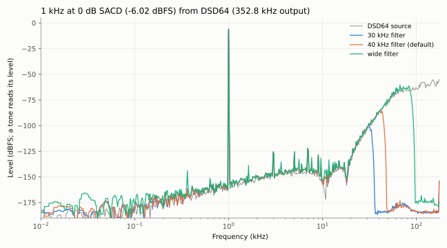

*1 kHz at 0 dB SACD through each filter: the tone, the test modulator's own low-level
spurs (also in the source), and DSD's noise rising above 20 kHz until each filter cuts
it.*

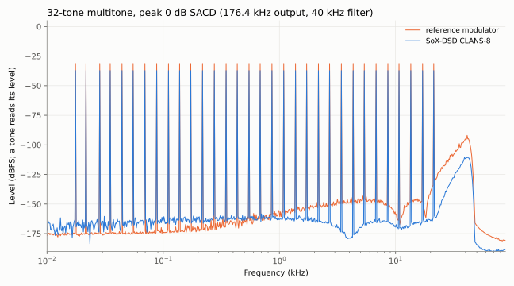

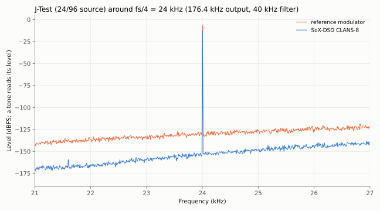

*J-Test, for file-level conversion an arithmetic test, not a jitter test: no sidebands at
the odd harmonics of fs/192 (500 Hz) around the 24 kHz tone rise above the DSD's noise.*

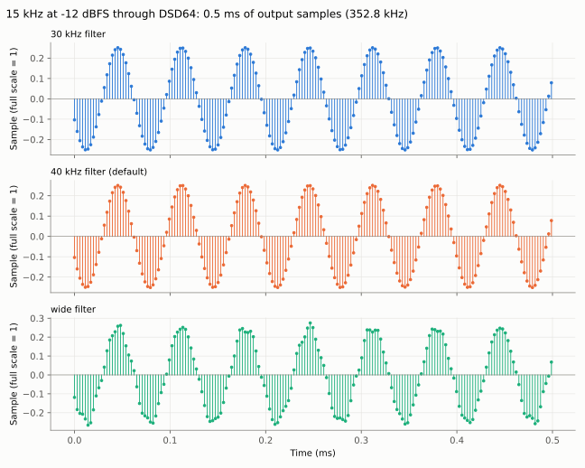

*[Archimago's 2015](https://archimago.blogspot.com/2015/04/analysis-dsd-to-pcm-2015-foobar-sacd.html) time-domain view: 15 kHz at -12 dBFS, the actual output samples. With
the 30 and 40 kHz filters the sine is clean; with the wide filter DSD64's ultrasonic noise
rides on it, as it does on any wide DSD64 decode.*

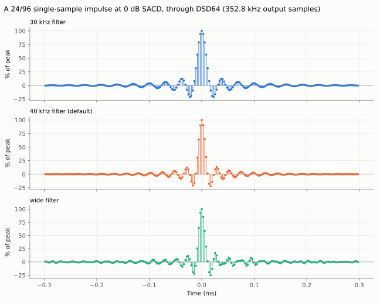

*A single 24/96 sample at 0 dB SACD, encoded to DSD64 and converted. The ringing is that
of the 24/96 impulse itself (it is band-limited to 48 kHz) and of each filter.*

## Filter floor with very quiet sources

The figures above are limited by the test signal. With a much quieter DSD64 source the
filters' own floor shows: about -128 dBFS in the audio band, -122 dBFS with the wide
filter. This is a measured limit of the filters, reproduced here after an external
measurement found it.

Measured with: dsd2pcm `fast` (its samples equal scarletbook-pcm 0.7.0's at every commit,
checked by the identity test) and the pysacd preset, with tools/quality as committed in
`4648fdf`, which added this section; dsd-measure not used.

**The source.** An 8th-order version of the reference modulator: noise transfer function
zeros at the roots of the 8th-order Legendre polynomial across 20 kHz, Butterworth poles,
largest noise gain 1.45 (at 1.5 it went unstable within 4 s at 0 dB SACD). It is defined at
the DSD rate, with no 24-bit PCM step. Its own THD+N for 1 kHz at 0 dB SACD, measured on the
bitstream, is -146.9 dB, a residual of -152.9 dBFS.

| Converter | SINAD, 1 kHz at 0 dB SACD (20 Hz-20 kHz) | Noise and distortion (dBFS) | THD (dB) |
|---|---:|---:|---:|
| The source itself (bitstream) | 146.9 dB | -152.9 | -163.5 |
| dsd2pcm, 30 or 40 kHz filter, any rate | 122.0 to 122.1 dB | -128.1 to -128.2 | -146 to -154 |
| dsd2pcm, wide filter (176.4 or 352.8 kHz) | 116.1 dB | -122.1 | -139 to -143 |
| pysacd preset, 88.2 / 176.4 kHz | 127.9 / 128.1 dB | -134.0 / -134.1 | -152 to -154 |
| The same taps in 64-bit floating point, no rounding, no word length (176.4 kHz: 30, 40, wide, pysacd) | 122.1, 122.1, 116.1, 128.3 dB | -128.2, -128.2, -122.1, -134.3 | -142 to -152 |

(scarletbook-pcm 0.7.0 gives the same samples as dsd2pcm here too.)

**The cause is the stopband, not the word length or distortion.** The exact taps in
floating point, with no rounding and no 24-bit output, give the same floor as the converter,
and the distortion (THD) is more than 20 dB below it. What remains is DSD64's ultrasonic noise
folding into the audio band from the bands around multiples of the output rates, where the
stopband is about 111 to 116 dB deep and DSD64's noise is at its loudest. Rejection of each
band that folds onto 0-20 kHz, from the taps (the smallest value in each band):

| Band (kHz) | 30 and 40 kHz filters | wide filter | pysacd preset |
|---|---:|---:|---:|
| 68-108 (88.2 kHz output only) | 111.5 / 111.9 dB | – | 127.2 dB |
| 156-196 (all but `wide` at 352.8 kHz) | 127.8 dB | 115.5 dB (176.4 kHz) | 135.5 dB |
| 333-373 | 115.6 dB | 111.3 dB | 114.7 dB |
| 686-726 | 114.5 dB | 111.0 dB | 126.0 dB |
| 1038-1078 | 116.3 dB | 111.3 dB | 130.2 dB |

Tones at those frequencies (-20 dB SACD, same quiet modulator) confirm it end to end. At
176.4 kHz the 700 kHz tone came out 121.8 dB down with the 40 kHz filter (taps: 122.0 dB at
that frequency), the 1050 kHz tone 124.9 dB down (taps: 125.0 dB), and with the wide filter
118.3 dB (taps: 117.9 dB). The 345 kHz tone reads 124.8 dB against 130.7 dB from the taps
because it is not alone: a 1-bit modulator also puts a spur at fs/2 - f (1411.2 - 345 =
1066.2 kHz), which folds onto the same audio frequency (7.8 kHz) and passes the stopband
there at about 125 dB. The band's smallest value above is the specification. (Rejection
here and below is relative to each tone's level as measured in the bitstream, not its
nominal level.)

**What it means.** The converter's floor in the audio band is about -128 dBFS (-122 dBFS
with `wide`), relative to a full scale at which 0 dB SACD reads -6.02 dBFS. It is below the
in-band noise of the 5th-order test signals on this page (-122.5 dBFS) and only shows with
a source that is quieter than that. A deeper stopband in the bands above lowers it, with
new filters and new output bytes: the [precise filter](#the-precise-filter), the default
from 0.2.0, is such a filter.

## The precise filter

`--filter precise` (`Filter::Precise`, `DSD2PCM_FILTER_PRECISE`) keeps everything that
makes `fast` exact (integer taps, exact sums, the same rounding, centring, linear
phase and cutoffs) and deepens the stopband to 150 dB and more wherever ultrasonic content
folds into the passband. How it is built is in [design](design.md#the-precise-filter-filterprecise).
It is the default from 0.2.0, the first release with it; `--filter fast` keeps
scarletbook-pcm's filter and bytes.

Measured with: dsd2pcm at commit `e5871b4` (the precise filter's tables are unchanged
since `6d4dfa7`, and golden hashes pin its output), tools/quality at that commit, ffmpeg
9.0.2 (Fedora 45), Python and its packages as under [reproducing](#reproducing-the-measurements);
dsd-measure not used. The host CPU of this run was not recorded; dsd2pcm's output is the
same bytes on every CPU and SIMD level.

**From the taps** (`filters.py --precise`; exact composite responses, as above; ripple is
the largest deviation from the gain at DC, either way):

| Rate (kHz) | Filter | Ripple to 20 kHz (dB) | -3 dB (kHz) | Stopband (dB) | Worst alias into 0-20 kHz (dB) | Images (dB) | Step overshoot (%) |
|---:|---|---:|---:|---:|---:|---:|---:|
| 88.2, 176.4 | fast, 30 / 40 kHz | ±0.0037 / ±0.0039 | 32.0 / 42.7 | 110.2 / 110.9 | 111.5 to 114.5 | – | 8.9 |
| 88.2, 176.4 | precise, 30 / 40 kHz | ±0.0019 | 32.0 / 42.6 | 157.8 | 158.0 | – | 8.9 |
| 352.8 | fast, 30 / 40 kHz | ±0.0037 / ±0.0039 | 32.0 / 42.7 | 110.2 / 110.9 | 114.5 | 119.3 | 8.9 |
| 352.8 | precise, 30 / 40 kHz | ±0.0022 / ±0.0021 | 32.0 / 42.6 | 157.8 | 158.0 | 194.0 | 8.9 |
| 176.4 | fast, wide | ±0.0039 | 82.7 | 109.7 | 111.0 | – | 8.9 |
| 176.4 | precise, wide | ±0.0016 | 82.7 | 151.3 | 151.3 | – | 8.9 |
| 352.8 | fast, wide | ±0.0040 | 85.3 | 111.1 | 111.1 | – | 8.9 |
| 352.8 | precise, wide | ±0.0016 | 85.3 | 151.3 | 151.3 | – | 8.9 |

Rejection of each band that folds onto 0-20 kHz (176.4 kHz output; `fast`'s in
brackets): 156-196 kHz 203.4 dB (127.8), 333-373 kHz 160.4 dB (115.6), 686-726 kHz
158.0 dB (114.5), 1038-1078 kHz 178.4 dB (116.3); with `wide` 179.0, 165.3, 151.3 and
172.5 dB (115.5, 111.3, 111.0, 111.3).

**Ringing.** The precise filter's two cascaded sharp filters make a longer impulse response,
mostly at low levels. Time the response stays above each level, each side of the peak
(40 kHz filter; the 30 kHz and wide filters are within a few per cent of the same ratios):

| Level | `fast` | precise | |
|---|---:|---:|---:|
| -40 dB | 0.156 ms | 0.169 ms | +8 % |
| -60 dB | 0.261 ms | 0.297 ms | +14 % |
| -80 dB | 0.337 ms | 0.398 ms | +18 % (30 kHz: +23 %) |
| -100 dB | 0.343 ms | 0.478 ms | +39 % |
| -120 dB | 0.350 ms | 0.536 ms | +53 % |
| Whole impulse response | 0.79 ms | 1.41 ms | |

Both are symmetric (linear phase), and the step overshoot is unchanged (8.9 %).

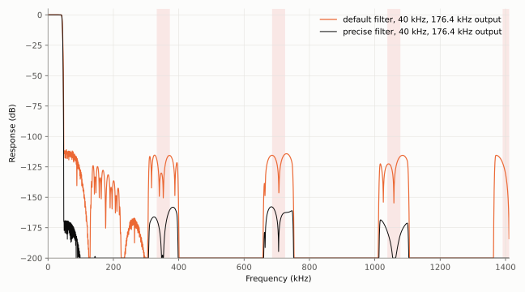

*The composite response of the 40 kHz filter at 176.4 kHz output, `fast` and precise, to
1.4112 MHz. The shaded bands fold onto 0-20 kHz. The precise filter is 150 dB or more down
in all of them; between them its first stage is left free, and the later stages remove
what it passes there.*

**End to end** (the 8th-order source above; the 5th-order signals; ffmpeg 9.0.2's DSD
decoder as a black box, `ffmpeg -i IN.dsf -ar RATE -c:a pcm_f32le OUT.wav`, 32-bit float
output, at its native 352.8 kHz and resampled to 176.4 kHz by its default resampler). The
tone column is the worst rejection of the `quiet_alias` tones that fold onto 0-20 kHz at
that rate, relative to each tone's level measured in the bitstream (`report.py` prints it,
with the `loud_alias` figures, as "Folding tones"):

| Converter | SINAD, 8th-order source (dB) | Noise and distortion (dBFS) | Noise, 5th-order modulated silence (dBFS) | Folding tones, worst rejection (dB) | Ultrasonic noise, 20 kHz to Nyquist at 352.8 kHz (dBFS) | DSD silence |
|---|---:|---:|---:|---:|---:|---|
| The source itself (bitstream) | 146.9 | -152.9 | -122.5 | – | – | – |
| fast, 30 / 40 kHz, any rate | 122.0 to 122.1 | -128.1 to -128.2 | -121.9 | 121.7 to 121.8 (700 kHz) | -88.3 / -70.2 | exact zero |
| fast, wide, 176.4 / 352.8 kHz | 116.1 | -122.1 | -118.8 | 117.9 / 118.0 | -50.2 | exact zero |
| precise, 30 / 40 kHz, 88.2 kHz | 141.8 | -147.8 | -122.5 | 153.0 / 152.6 | – | exact zero |
| precise, 30 / 40 kHz, 176.4 kHz | 143.6 | -149.6 | -122.5 | 155.3 / 154.6 | – | exact zero |
| precise, 30 / 40 kHz, 352.8 kHz | 144.9 | -150.9 | -122.5 | 157.4 / 159.0 | -88.5 / -70.3 | exact zero |
| precise, wide, 176.4 / 352.8 kHz | 143.6 / 144.8 | -149.6 / -150.8 | -122.5 | 153.6 / 158.0 | -50.3 | exact zero |
| precise taps in 64-bit floating point, no rounding, no word length (176.4 kHz, 40 / wide) | 146.7 / 146.5 | -152.7 / -152.5 | – | 159.8 / 158.6 | – | – |
| ffmpeg, 352.8 kHz (float) | 146.7 | -152.7 | -122.5 | 152.9 | -38.0 | peaks of -46 dBFS |
| ffmpeg, 176.4 kHz (float, resampled) | 138.9 | -145.0 | -122.5 | 122.0 (170 kHz) | – | peaks of -52 dBFS |

- **The precise filter removes the filter floor.** SINAD with the quiet source rises from
  122 dB to 142 to 145 dB (from 116 to 144 dB with `wide`), and every tone that folds onto
  the audio band is 152 dB or more down (118 to 122 dB with `fast`).
- **The tone figures for precise are lower bounds.** Each reading is the tone's level over
  what the output shows at the alias frequency, and with the precise filter that is mostly
  the output's own noise in the tone's FFT lobe (24-bit rounding and the source's noise,
  near -180 dBFS here), not the leaked tone. The `loud_alias` signal settles it: 11 tones
  across 333-1078 kHz at about -8 dBFS, detected narrow-band (a 2 s projection at the
  exact alias frequency, with the floor read beside it), so the measurement's ceiling is
  184 to 188 dB. The precise filter measures 157.5 dB at worst (686 kHz; 30 and 40 kHz,
  every rate) and 151.0 dB with `wide` (723.7 kHz), against 158.0 and 151.3 dB from the
  taps; `fast` 114.5 dB (723.7 kHz; `wide` 111.2 dB), ffmpeg 152.5 dB (345 kHz).
- **What is left is the 24-bit output, not the filter.** The same taps in floating point
  give 146.7 dB, the source's own 146.9 dB. The 24-bit rounding adds -152.7 dBFS in
  20 Hz-20 kHz at 176.4 kHz (-149.7 at 88.2, -155.7 at 352.8 kHz), and the source's -152.9
  plus that is -149.8, -148.2 and -151.1 dBFS: within 0.4 dB of what was measured. The
  rounding between stages (on the 2^26 grid) adds less than that.
- **ffmpeg** reaches the source's figure at 352.8 kHz because its output is floating point
  with no word length, and its rejection of what folds onto the audio band (152.5 to
  184 dB on the tones of both runs) is in the precise filter's class. What it lacks is ultrasonic
  filtering: at 352.8 kHz it passes DSD64's noise up to its Nyquist frequency (-38.0 dBFS
  from 20 kHz up, a 170 kHz tone 13 dB down), and the SACD silence pattern converts to a
  signal peaking at -46 dBFS instead of digital zero. At 176.4 kHz its default resampler
  sets the limits: SINAD 138.9 dB and a 170 kHz tone folded at 122.0 dB.
- **With the 5th-order signals** both filters measure the source: THD+N -106.1 dB, noise
  -122.5 dBFS for precise against -121.9 dBFS (`fast`, 30 and 40 kHz) and -118.8 dBFS
  (`fast`, wide). The ultrasonic bands are the same within 0.2 dB.

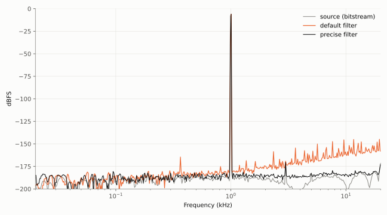

*1 kHz at 0 dB SACD from the 8th-order source, 176.4 kHz output, 40 kHz filter: the `fast`
filter's floor rises above 3 kHz with folded ultrasonic noise; the precise filter follows
the source.*

**Real discs.** Three DSD64 tracks (rock, rock, voice with guitar and piano), converted at
176.4 kHz with both filters: the two outputs differ by -94 to -99 dBFS in 20 Hz-20 kHz,
about 75 dB below the music, almost all of it the two filters' passband ripples (both
within ±0.004 dB). In the quietest second of the one track with a near-silent lead-in the
floor fell from -124.6 to -125.7 dBFS (the difference, -131.0 dBFS, is the folded noise
the precise filter removes). On these masters the recording's own noise sets the floor
with either filter; in the quietest second the precise filter lowered it by 1.1 dB. Its lower floor
shows most with sources quieter than `fast`'s -128 dBFS, and in measurements.

**Limits, stated plainly.**

- **CPU time:** 1.30 to 1.91 times scarletbook-pcm 0.7.0's on an Intel Core i9-13900H
  ([performance](performance.md#precise-and-fast-against-scarletbook-pcm-070)); 1.5 to 2.3
  times `fast`'s on one core (about 1.8 times for 30 and
  40 kHz at 176.4 and 352.8 kHz; 2 to 2.3 times at 88.2 kHz and for `wide` at 176.4 kHz),
  1.15 to 2.0 times on all cores; see [performance](performance.md#precise-against-fast-by-rate-and-cutoff). It
  still converts at 90 to 190 times real time on one Zen 2 core, and at 32 times or more on
  an E-core of the i9-13900H.
- **Ringing:** longer, mostly below -80 dB: +14 % at -60 dB, +53 % at -120 dB, and an
  impulse response of 1.41 ms against 0.79 ms in all (table above). It is symmetric,
  ultrasonic (at the transition band) and the step overshoot is unchanged.
- **Not scarletbook-pcm's bytes:** its output differs from scarletbook-pcm 0.7.0's (by the
  amounts above); it is exact and identical on every CPU and SIMD level, pinned by its own
  golden hashes.
- **Word length:** with the 24-bit output the audio-band floor is the rounding's, about
  -150 dBFS. A floating-point output would be needed to show the last 3 dB.

## The 30 kHz filter against a separate low-pass

[Archimago found in 2015](https://archimago.blogspot.com/2015/04/analysis-dsd-to-pcm-2015-foobar-sacd.html) that a converter's built-in 30 kHz mode measured worse than a wide
decode followed by a separate, high-quality 30 kHz low-pass. The same test here: the
352.8 kHz wide output, filtered by a 583-tap Kaiser-windowed linear-phase low-pass (pass
30 kHz, stop 36 kHz, 150 dB, in 64-bit floating point; `postfilter.py`), against dsd2pcm's
own 30 kHz filter.

| | dsd2pcm 30 kHz filter | wide decode + reference 30 kHz low-pass |
|---|---:|---:|
| Noise, 20 Hz-20 kHz | -121.9 dBFS | -118.8 dBFS |
| Noise, 20 Hz-20 kHz, A-weighted | -123.8 dBFS | -121.2 dBFS |
| Noise, 20-40 kHz | -88.3 dBFS | -87.3 dBFS |
| Noise, 40-96 kHz | -150.9 dBFS | below -200 dBFS |
| THD+N, 1 kHz at 0 dB SACD | -106.0 dB | -105.6 dB |

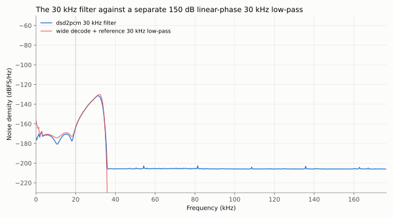

dsd2pcm's 30 kHz filter measures 3.1 dB less noise in the audio band (2.6 dB A-weighted)
and 0.4 dB lower THD+N: a separate low-pass cannot remove noise that an earlier wide stage
has already folded into the band. From 40 kHz up the reference low-pass goes deeper
(below -200 against -150.9 dBFS in 40-96 kHz; it is not limited by 24-bit output).

## Comparisons

**scarletbook-pcm 0.7.0: `fast` is identical, by construction and by test.** dsd2pcm's
`fast` filter is scarletbook-pcm's: the taps are copied unchanged and the arithmetic is exact
integer arithmetic, so the output does not depend on the order of the sums (see
[design](design.md#the-exactness-proof-and-fma)). Both were run on every DSD64 test signal
at every rate and cutoff: 272 of 272 outputs had the same samples (equal SHA-256 of the
decoded samples). Every `fast` measurement on this page therefore applies to scarletbook-pcm 0.7.0, and to
programs that use it, unchanged.

**The pysacd preset (`--filter pysacd`).** pysacd's own filter, with its taps and response:
three Kaiser-windowed linear-phase FIR stages and a TPDF-dithered 24-bit quantiser, at 88.2
and 176.4 kHz. Since 0.2.0 it computes in 64-bit floating point, where pysacd computes in
32-bit ([design](design.md#the-pysacd-preset)). Measured the same way:

| | pysacd preset 88.2 kHz | pysacd preset 176.4 kHz | dsd2pcm `fast`, 40 kHz |
|---|---:|---:|---:|
| Passband ripple to 20 kHz | ±0.0001 dB | ±0.0001 dB | ±0.0039 dB |
| -3 dB point | 43.4 kHz | 71.9 kHz | 42.7 kHz |
| Stopband | 109.8 dB from 48 kHz | 111.2 dB from 88.2 kHz | 110.9 dB from 48 kHz |
| Ringing above -60 dB, each side | 0.29 ms | 0.09 ms | 0.26 ms |
| Step overshoot | 8.9 % | 8.8 % | 8.9 % |
| Noise, 20 Hz-20 kHz | -120.9 dBFS | -120.9 dBFS | -121.9 dBFS |
| Noise above 20 kHz | -69.3 dBFS | -54.1 dBFS | -70.2 dBFS |
| THD+N, 1 kHz at 0 dB SACD | -106.1 dB | -106.1 dB | -105.9 dB |
| DSD silence | ±1 LSB of dither | ±1 LSB of dither | exact zero |
| Time offset against the DSD timeline | 3.0 µs (0.27 samples) | 2.7 µs (0.47 samples) | none |

- **Where it is better:** a flatter passband (Kaiser windows instead of equiripple), and at
  176.4 kHz a gentler roll-off (-3 dB at 72 kHz) with shorter ringing.
- **Where it is worse:** its TPDF dither adds 1 dB of in-band noise and turns DSD silence
  into noise; at 176.4 kHz it passes DSD64's noise up to about 80 kHz (-54 dBFS above 20 kHz,
  16 dB more than the 40 kHz filter); and its output is offset from the DSD timeline by a
  fraction of a sample (constant, the same in both channels).
- **Use the preset for pysacd's response.** Its bytes are this crate's own: 0.1.x matched pysacd's 32-bit reference build, and pysacd's released
  builds differ by CPU.

**Its arithmetic.** In 32-bit floating point, summed strictly in tap order (dsd2pcm 0.1.x),
the filter loses SINAD at high levels. Measured with dsd-measure 0.1.1 (quick profile, 1 kHz
at 0 dB SACD, three dither draws each, spread at most 0.05 dB):

| | 88.2 kHz | 176.4 kHz |
|---|---:|---:|
| 0.1.x, 32-bit | 127.25 dB | 127.88 dB |
| pysacd 0.5.x wheels (the same signals, through pysacd's own converter) | 127.81 dB | 128.07 dB |
| 0.2.0, 64-bit | 127.97 dB | 128.13 dB |
| precise filter, for scale | 141.91 dB | 143.79 dB (wide: 143.73 dB) |

The noise floor does not move (-130.7 / -130.8 dBFS in that measurement): it comes from the
Kaiser stopbands, not from the arithmetic. The 64-bit path costs CPU time. Real time per
core, one thread, a 180 s synthetic track, whole conversion (best of three repeats of best
of five; the machine was shared, so read these as rough):

| Channels, rate, level | 0.1.x, 32-bit | 0.2.0, 64-bit | precise |
|---|---:|---:|---:|
| 2, 88.2 kHz, AVX2 | 273× | 209× | 208× |
| 2, 88.2 kHz, generic | 193× | 108× | 143× |
| 2, 176.4 kHz, AVX2 | 295× | 248× | 178× |
| 2, 176.4 kHz, generic | 221× | 147× | 123× |
| 6, 88.2 kHz, AVX2 | 88× | 69× | 68× |
| 6, 88.2 kHz, generic | 65× | 36× | 48× |
| 6, 176.4 kHz, AVX2 | 95× | 81× | 59× |
| 6, 176.4 kHz, generic | 76× | 50× | 41× |

**sacd_extract.** The sacd_extract build available to us (the commonly distributed
command-line tool, run as a black box) has no PCM output: it writes DSF, DSDIFF or an ISO
image (`-s`, `-p`, `-e`, `-I`) and nothing else, so there is no PCM of its own to compare.
Its DSF output is the input of a decoder such as dsd2pcm, not a competitor to it.

**The foobar2000 SACD plug-in.** foo_input_sacd 2.0.27 (the current release, SHA-256 of
its download equal to the one SourceForge publishes) in foobar2000 2.26.3 x64, on Windows 11
in a virtual machine. The plug-in was run as a black box: the same DSF test files went in,
and only its output files were measured, with the same scripts. Settings: output PCM,
volume 0 dB (the plug-in's default is +6 dB), LFE 0, decimation Auto, no ramp; foobar2000's
converter writing 32-bit float WAV, no dither, no DSP, no ReplayGain, decode postprocessing
off. Each of its conversion modes was run at 352.8 kHz: Multistage (the default) and
Direct with a 30 kHz low-pass, each in 32-bit and 64-bit floating point, and Installable
FIR with each of the four filter files it ships (30, 40, 50 and 60 kHz, 641 taps); the
default mode also at 176.4 kHz. The 32-bit and 64-bit float variants measured the same
except where noted, so the tables show one of each.

Measured with: the plug-in's output files analysed by tools/quality as committed in `cd25bca`
beside dsd2pcm `fast` (samples equal to scarletbook-pcm 0.7.0's at every commit); dsd-measure
not used. The analysis ran on the host under [reproducing](#reproducing-the-measurements);
the CPU of the Windows virtual machine's host was not recorded.

**Levels match.** At volume 0 dB the plug-in maps 100 % modulation to full scale, as
dsd2pcm does: 0 dB SACD reads -6.02 dBFS in both, so no level correction was applied. Its
default of +6 dB would put 0 dB SACD at full scale, where the +3.1 dB SACD peak level clips
(its output is floating point, so the overs survive in the file but not in a fixed-point
DAC).

| Decoder and setting | Noise level, dB(A) | Dynamic range, dB(A) | THD, % | THD+N, dB | IMD+N SMPTE, % | IMD CCIF, % | Crosstalk at 1 kHz, dB | Frequency response 20 Hz-20 kHz, dB |
|---|---:|---:|---:|---:|---:|---:|---|---|
| dsd2pcm 352.8 kHz, 40 kHz (for reference) | -117.8 | 107.0 | 0.00023 | -106.0 | 0.00059 | 0.00073 | -161.3 | -0.002, +0.003 |
| foobar2000 SACD: Multistage (32fp), 352.8 kHz (default mode) | -118.2 | 107.1 | 0.00023 | -106.1 | 0.00060 | 0.00074 | -161.6 | -0.001, +0.002 |
| foobar2000 SACD: Multistage (32fp), 176.4 kHz | -118.2 | 107.1 | 0.00023 | -106.1 | 0.00058 | 0.00083 | -161.5 | -0.001, +0.002 |
| foobar2000 SACD: Multistage (64fp), 352.8 kHz | -118.2 | 107.1 | 0.00023 | -106.1 | 0.00060 | 0.00074 | -161.6 | -0.001, +0.002 |
| foobar2000 SACD: Direct (32fp, 30kHz lowpass) | -115.4 | 107.0 | 0.00023 | -106.0 | 0.00060 | 0.00072 | -154.1 | -0.113, +0.000 |
| foobar2000 SACD: Direct (64fp, 30kHz lowpass) | -115.4 | 107.0 | 0.00023 | -106.0 | 0.00060 | 0.00072 | -154.1 | -0.113, +0.000 |
| foobar2000 SACD: Installable FIR (64fp), 30 kHz filter | -118.2 | 107.1 | 0.00023 | -106.2 | 0.00060 | 0.00072 | -162.0 | -0.299, +0.000 |
| foobar2000 SACD: Installable FIR (64fp), 40 kHz filter | -118.2 | 107.1 | 0.00023 | -106.1 | 0.00060 | 0.00074 | -162.0 | -0.001, +0.002 |
| foobar2000 SACD: Installable FIR (64fp), 50 kHz filter | -118.2 | 107.1 | 0.00023 | -106.1 | 0.00060 | 0.00074 | -162.1 | -0.001, +0.002 |
| foobar2000 SACD: Installable FIR (64fp), 60 kHz filter | -118.2 | 107.1 | 0.00023 | -106.1 | 0.00060 | 0.00074 | -162.1 | -0.001, +0.002 |

| Mode | 0 dB SACD reads (dBFS) | Noise 20 Hz-20 kHz (dBFS) | Noise above 20 kHz (dBFS) | Peak sample, +3.1 dB SACD tone (dBFS) | DSD silence (0x69) | Ringing above -60 dB, each side (ms) |
|---|---:|---:|---:|---:|---|---:|
| dsd2pcm 352.8 kHz, 40 kHz | -6.02 | -121.9 | -70.2 | -2.09 | exact zero | 0.261 |
| dsd2pcm 352.8 kHz, wide | -6.02 | -118.8 | -50.2 | -1.68 | exact zero | 0.130 |
| Multistage (32fp), 352.8 kHz (default mode) | -6.02 | -122.5 | -35.1 | -0.87 | not zero: up to -37.3 dBFS | 0.011 |
| Multistage (32fp), 176.4 kHz | -6.02 | -122.5 | -49.9 | -2.10 | not zero: up to -24.5 dBFS | 0.074 |
| Multistage (64fp), 352.8 kHz | -6.02 | -122.5 | -35.1 | -0.87 | not zero: up to -26.7 dBFS | 0.011 |
| Direct (32fp, 30kHz lowpass) | -6.02 | -118.8 | -91.9 | -2.92 | not zero: up to -22.0 dBFS | 0.088 |
| Direct (64fp, 30kHz lowpass) | -6.02 | -118.8 | -91.9 | -2.92 | not zero: up to -22.0 dBFS | 0.088 |
| Installable FIR (64fp), 30 kHz filter | -6.02 | -122.6 | -90.6 | -2.92 | not zero: up to -22.0 dBFS | 0.077 |
| Installable FIR (64fp), 40 kHz filter | -6.02 | -122.5 | -74.7 | -2.90 | not zero: up to -21.9 dBFS | 0.071 |
| Installable FIR (64fp), 50 kHz filter | -6.02 | -122.5 | -64.6 | -2.86 | not zero: up to -21.5 dBFS | 0.074 |
| Installable FIR (64fp), 60 kHz filter | -6.02 | -122.5 | -59.1 | -2.73 | not zero: up to -20.7 dBFS | 0.071 |

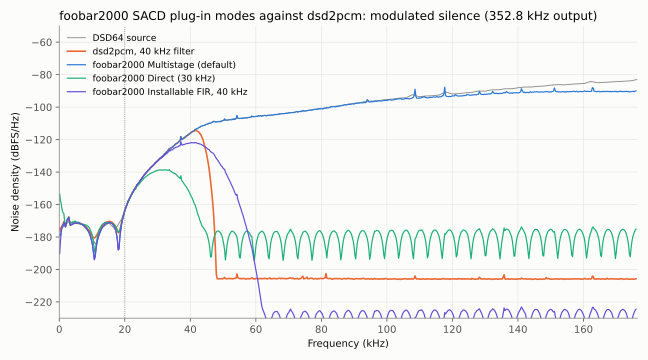

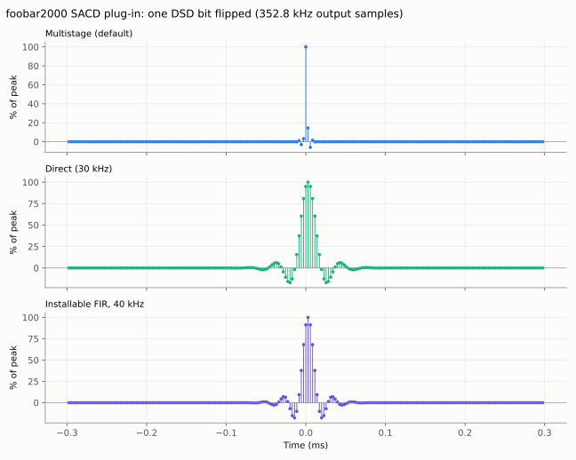

What the numbers say:

- **In the audio band the two are equal within 0.6 dB, and the plug-in is the slightly
  quieter one.** Its Multistage and Installable FIR modes leave exactly the source's noise
  (-122.5 dBFS) where dsd2pcm's 110 dB stopband lets 0.6 dB more fold in. THD+N, IMD and
  dynamic range are the same: all of them are the test signal's.
- **The default Multistage mode filters little at 352.8 kHz.** It passes DSD64's noise
  almost unchanged to 176 kHz (-35 dBFS above 20 kHz, against -70 dBFS with dsd2pcm's
  default), and its impulse response is close to a single sample (0.011 ms above -60 dB).
  Of the modes measured it passes the most ultrasonic noise and leaves the least
  headroom: a tone at the +3.1 dB SACD peak level gave sample peaks of -0.87 dBFS
  (-2.09 dBFS with dsd2pcm). At 176.4 kHz it passes the noise up to that rate's Nyquist
  frequency (-49.9 dBFS above 20 kHz, like dsd2pcm's wide filter).
- **Direct (30 kHz) folds noise into the band**: -118.8 dBFS in 20 Hz-20 kHz, 3.7 dB above
  the source, and the response is already -0.11 dB at 20 kHz. Its stopband is visibly
  shallower than the installable filters' (the noise plot). Archimago found the same mode
  weak in 2015.
- **Installable FIR** filters roll off more gently than dsd2pcm's (the "40 kHz" one reaches
  its stopband only around 60 kHz, see the noise plot) and then go deeper; the 30 kHz one
  droops by 0.3 dB at 20 kHz.
- **DSD silence is not digital zero.** A file of DSD silence (`0x69`) gets a short
  transient in its first samples (up to -22 dBFS, depending on the mode: a click), and the
  Direct mode leaves a floor of about -117 dBFS on it. dsd2pcm treats the input as continuing with DSD
  silence before its first byte, so its first samples are exact zero.
- **The alignment varies from file to file.** Against the DSD timeline (dsd2pcm's output is
  centred on it by design), the plug-in's output is 0 to 1 samples late on some files and
  40 to 41 samples later (about 116 µs at 352.8 kHz, 227 µs at 176.4 kHz) on others, in
  every mode, with the file length unchanged; we did not find what decides it. Both
  channels move together (no offset between them), but files converted from the same DSD
  do not line up sample for sample.
- **Higher DSD rates:** the plug-in's DSD128 and DSD256 outputs carry 18.8 and 19.5 dB
  less in-band noise than DSD64 (below), within 3 dB of their sources; dsd2pcm does not
  convert those rates yet.

| Source | THD+N, 1 kHz at 0 dB SACD (dB) | Noise 20 Hz-20 kHz (dBFS) | Noise above 20 kHz (dBFS) |
|---|---:|---:|---:|
| DSD64, foobar2000 Multistage (64fp), 352.8 kHz | -106.1 | -122.5 | -35.1 |
| DSD128, foobar2000 Multistage (64fp), 352.8 kHz | -135.1 | -141.3 | -49.2 |
| DSD256, foobar2000 Multistage (64fp), 352.8 kHz | -137.9 | -142.0 | -67.8 |
| DSD64 source itself | -106.1 | -122.5 | – |
| DSD128 source itself | -135.6 | -144.3 | – |
| DSD256 source itself | -139.0 | -144.9 | – |

**"DSD to PCM in a player".** Most players that convert DSD on the fly use the same kind
of filter: a multistage linear-phase low-pass, often with a cutoff between 24 and 50 kHz,
sometimes in single-precision floating point and sometimes with a +6 dB level boost. The
differences that can matter are the level (a +6 dB boost clips the +3.1 dB SACD peaks
unless the player has headroom), the cutoff (how much ultrasonic noise reaches the
amplifier) and dither. They were not measured here; the method above can measure any of
them from their output files.

## Questions people ask

**Is DSD to PCM lossy?** In the audio band the measured differences are small. DSD64 carries the music below
about 20 kHz and pushes its quantisation noise above it; the conversion keeps the first and
removes most of the second. Inside 20 kHz the output differs from the DSD's own content by
the filter's ripple (±0.004 dB) and by the 24-bit rounding, whose noise is 30 dB below
the test DSD64's own noise in that band. What is lost is
ultrasonic: above the cutoff the output keeps little or nothing, and with the 30 and 40 kHz
filters that is mostly DSD's own shaped noise, not music.

**Why not 768 kHz?** Above about 50 kHz a DSD64 stream
is mostly its own shaped noise (see the ultrasonic plot), so a higher output rate would
store more of that noise, not more music. 352.8 kHz, with the wide filter, already keeps
everything to 80 kHz. The rates are exact divisors of 2.8224 MHz (by 32, 16 and 8), so no
fractional resampling is ever done.

**Why no minimum-phase filter?** A minimum-phase filter moves all the ringing after the
transient, at the cost of a frequency-dependent delay (phase distortion) in the passband.
dsd2pcm's filters ring at about 43 kHz (the 30 kHz filter at about 33 kHz, wide at about
84 kHz), above the 20 kHz audio band, for a quarter to a third of a millisecond, and the ringing is only
excited by content in the transition band, which in DSD64 is almost entirely the modulator's noise. Linear phase
also keeps the output an exact, symmetric function of the input, which deterministic
output relies on. There is no minimum-phase or apodizing option; the pysacd preset is
linear phase too.

**Does the output rate matter if my DAC upsamples anyway?** A little, in what reaches the
DAC: at 88.2 kHz everything above 44.1 kHz is gone, at 176.4 and 352.8 kHz the 40 kHz
filter still ends at 48 kHz, so the audio band and its filter are the same. What changes
is the DAC's own filter: at 88.2 kHz it must cut between 40 and 44.1 kHz, at 176.4 kHz it
has much more room. If your DAC accepts 176.4 kHz, use it (the default); choose 88.2 kHz to
save space, 352.8 kHz with `wide` if you want the ultrasonic band kept.

**Should I use `--gain +6`?** Not by default. +6 dB puts 0 dB SACD at full scale, so every
peak above 0 dB SACD clips, and the Scarlet Book allows peaks to +3.1 dB SACD. For louder
files use at most about +2 dB with the 40 kHz filter and +1.5 dB with `wide`: a tone at the
peak level reached -2.1 and -1.7 dBFS here, because DSD's own ultrasonic noise adds to the
peaks (Archimago's +2.5 dB, 2022, allows for the tone alone). The default keeps every
legal level, and dsd2pcm counts clipped samples if a disc exceeds them.

## Reproducing the measurements

The [tools/quality README](../tools/quality/README.md) lists the scripts. The figures on
this page were made with:

- dsd2pcm at commit `172eb97` (the converter and the command line are unchanged up to `76307f6`, the base of this page), built with Rust 1.100.0 (`cargo build
  --release -p dsd2pcm-cli`), on Linux x86_64 (an AMD Ryzen AI MAX+ 395);
- scarletbook-pcm 0.7.0 from crates.io (`tools/quality/sbpcm`);
- Python 3.15.2 with numpy 2.5.5, scipy 1.18.1 and matplotlib 3.11.2
  ([requirements.txt](../tools/quality/requirements.txt));
- no dsd-measure: every figure on this page is from tools/quality;
- SoX-DSD at commit `0be259e` of [mansr/sox](https://github.com/mansr/sox), built with
  CMake, for the three signals that have a SoX-DSD version: build it and replace `--no-sox`
  with `--sox` and the path of its `sox` program.

From the repository root:

<!-- docs-run: skip="needs a checkout, Rust and the quality tools in a Python venv" -->
```sh
python3 -m venv venv
venv/bin/pip install -r tools/quality/requirements.txt
cargo build --release -p dsd2pcm-cli
cargo build --release --manifest-path tools/quality/sbpcm/Cargo.toml
venv/bin/python tools/quality/gen_signals.py --out out/sig --no-sox
venv/bin/python tools/quality/decode.py --signals-dir out/sig --out out/dec --tool dsd2pcm=target/release/dsd2pcm --tool sbpcm=tools/quality/sbpcm/target/release/sbpcm-ref
venv/bin/python tools/quality/postfilter.py --in out/dec/dsd2pcm/352k8-wide --out out/dec/lp30-ref/352k8
mkdir -p out/dec/taps-f64/176k4-30 out/dec/taps-f64/176k4-40 out/dec/taps-f64/176k4-wide out/dec/taps-f64/176k4-pysacd
venv/bin/python tools/quality/filters.py --tables crates/dsd2pcm/src/decimator/tables.rs --pysacd crates/dsd2pcm/src/filters/pysacd_taps.rs --apply out/sig/dsd/quiet_sine1k-dsd-dsd64-ref.dsf --rate 176400 --cutoff 30 --out out/dec/taps-f64/176k4-30/quiet_sine1k-dsd-dsd64-ref.wav
venv/bin/python tools/quality/filters.py --tables crates/dsd2pcm/src/decimator/tables.rs --pysacd crates/dsd2pcm/src/filters/pysacd_taps.rs --apply out/sig/dsd/quiet_alias-dsd-dsd64-ref.dsf --rate 176400 --cutoff 30 --out out/dec/taps-f64/176k4-30/quiet_alias-dsd-dsd64-ref.wav
venv/bin/python tools/quality/filters.py --tables crates/dsd2pcm/src/decimator/tables.rs --pysacd crates/dsd2pcm/src/filters/pysacd_taps.rs --apply out/sig/dsd/quiet_sine1k-dsd-dsd64-ref.dsf --rate 176400 --cutoff 40 --out out/dec/taps-f64/176k4-40/quiet_sine1k-dsd-dsd64-ref.wav
venv/bin/python tools/quality/filters.py --tables crates/dsd2pcm/src/decimator/tables.rs --pysacd crates/dsd2pcm/src/filters/pysacd_taps.rs --apply out/sig/dsd/quiet_alias-dsd-dsd64-ref.dsf --rate 176400 --cutoff 40 --out out/dec/taps-f64/176k4-40/quiet_alias-dsd-dsd64-ref.wav
venv/bin/python tools/quality/filters.py --tables crates/dsd2pcm/src/decimator/tables.rs --pysacd crates/dsd2pcm/src/filters/pysacd_taps.rs --apply out/sig/dsd/quiet_sine1k-dsd-dsd64-ref.dsf --rate 176400 --cutoff wide --out out/dec/taps-f64/176k4-wide/quiet_sine1k-dsd-dsd64-ref.wav
venv/bin/python tools/quality/filters.py --tables crates/dsd2pcm/src/decimator/tables.rs --pysacd crates/dsd2pcm/src/filters/pysacd_taps.rs --apply out/sig/dsd/quiet_alias-dsd-dsd64-ref.dsf --rate 176400 --cutoff wide --out out/dec/taps-f64/176k4-wide/quiet_alias-dsd-dsd64-ref.wav
venv/bin/python tools/quality/filters.py --tables crates/dsd2pcm/src/decimator/tables.rs --pysacd crates/dsd2pcm/src/filters/pysacd_taps.rs --apply out/sig/dsd/quiet_sine1k-dsd-dsd64-ref.dsf --rate 176400 --cutoff pysacd --out out/dec/taps-f64/176k4-pysacd/quiet_sine1k-dsd-dsd64-ref.wav
venv/bin/python tools/quality/filters.py --tables crates/dsd2pcm/src/decimator/tables.rs --pysacd crates/dsd2pcm/src/filters/pysacd_taps.rs --apply out/sig/dsd/quiet_alias-dsd-dsd64-ref.dsf --rate 176400 --cutoff pysacd --out out/dec/taps-f64/176k4-pysacd/quiet_alias-dsd-dsd64-ref.wav
venv/bin/python tools/quality/analyse.py --signals-dir out/sig --decoded out/dec --out out/results.json --curves out/curves.json --sources idle,silence,sine1k_0,level_steps,smpte,ccif,fr_tones,xtalk_l,alias_steps,multitone,jtest,quiet_sine1k,quiet_alias
venv/bin/python tools/quality/filters.py --tables crates/dsd2pcm/src/decimator/tables.rs --pysacd crates/dsd2pcm/src/filters/pysacd_taps.rs --out out/filters.json
venv/bin/python tools/quality/plot.py --filters out/filters.json --results out/results.json --curves out/curves.json --out docs/assets/quality
venv/bin/python tools/quality/report.py --filters out/filters.json --results out/results.json
```

The pysacd preset's rows were measured again for 0.2.0 (its `f64` arithmetic) with the
same scripts and signals, the pysacd decoder only (`decode.py ... --decoders pysacd`), at
commit 4504b6e; the 0.1.x build gave the old rows again.

The [precise filter](#the-precise-filter)'s figures were made with the same tools, ffmpeg 9.0.2 (Fedora 45) and only the signals they
use:

<!-- docs-run: skip="needs a checkout, Rust, the quality tools in a Python venv and ffmpeg" -->
```sh
venv/bin/python tools/quality/gen_signals.py --out out/sig --no-sox --only idle,silence,sine1k_0,fr_tones,alias_steps,bit_impulse,bit_step,quiet_sine1k,quiet_alias,loud_alias
venv/bin/python tools/quality/decode.py --signals-dir out/sig --out out/dec --tool dsd2pcm=target/release/dsd2pcm --tool ffmpeg=/usr/bin/ffmpeg --decoders dsd2pcm,dsd2pcm-precise,ffmpeg
mkdir -p out/dec/taps-f64-precise/176k4-40 out/dec/taps-f64-precise/176k4-wide
venv/bin/python tools/quality/filters.py --tables crates/dsd2pcm/src/decimator/tables.rs --precise crates/dsd2pcm/src/decimator/tables_precise.rs --apply out/sig/dsd/quiet_sine1k-dsd-dsd64-ref.dsf --rate 176400 --cutoff precise-40 --out out/dec/taps-f64-precise/176k4-40/quiet_sine1k-dsd-dsd64-ref.wav
venv/bin/python tools/quality/filters.py --tables crates/dsd2pcm/src/decimator/tables.rs --precise crates/dsd2pcm/src/decimator/tables_precise.rs --apply out/sig/dsd/quiet_alias-dsd-dsd64-ref.dsf --rate 176400 --cutoff precise-40 --out out/dec/taps-f64-precise/176k4-40/quiet_alias-dsd-dsd64-ref.wav
venv/bin/python tools/quality/filters.py --tables crates/dsd2pcm/src/decimator/tables.rs --precise crates/dsd2pcm/src/decimator/tables_precise.rs --apply out/sig/dsd/quiet_sine1k-dsd-dsd64-ref.dsf --rate 176400 --cutoff precise-wide --out out/dec/taps-f64-precise/176k4-wide/quiet_sine1k-dsd-dsd64-ref.wav
venv/bin/python tools/quality/filters.py --tables crates/dsd2pcm/src/decimator/tables.rs --precise crates/dsd2pcm/src/decimator/tables_precise.rs --apply out/sig/dsd/quiet_alias-dsd-dsd64-ref.dsf --rate 176400 --cutoff precise-wide --out out/dec/taps-f64-precise/176k4-wide/quiet_alias-dsd-dsd64-ref.wav
venv/bin/python tools/quality/analyse.py --signals-dir out/sig --decoded out/dec --out out/results.json --curves out/curves.json --sources quiet_sine1k,quiet_alias,loud_alias,silence,sine1k_0
venv/bin/python tools/quality/filters.py --tables crates/dsd2pcm/src/decimator/tables.rs --pysacd crates/dsd2pcm/src/filters/pysacd_taps.rs --precise crates/dsd2pcm/src/decimator/tables_precise.rs --out out/filters.json
venv/bin/python tools/quality/report.py --filters out/filters.json --results out/results.json
```

The two precise charts are `plot_precise` in `plot.py`. The real-disc comparison used
three commercial DSD64 tracks, which are not distributed.

The foobar2000 rows come from WAVs made on Windows as described under
[comparisons](#comparisons) and copied to `out/dec/foobar/<mode>-<rate>/` before
`analyse.py`; without them those rows and two charts are left out.

The inputs are generated, not downloaded; with the same versions the DSD files, the
decoded WAVs and the numbers are identical on every run. Without SoX-DSD the multitone and
J-Test charts lose their SoX-DSD line, and the scarletbook-pcm comparison covers 224
outputs instead of 272. These commands were run in a fresh clone on 2026-11-23: every other
chart and every table came out identical. Only the charts are committed.

## References

- Archimago, [Archimago's Musings](https://archimago.blogspot.com/):
  [DSD to PCM, 2015](https://archimago.blogspot.com/2015/04/analysis-dsd-to-pcm-2015-foobar-sacd.html);
  [DSD and SoX-DSD, 2021](https://archimago.blogspot.com/2021/10/measurements-look-at-dsd-and-using-sox.html);
  [DAC DSD (1-bit PDM) measurements, 2022](https://archimago.blogspot.com/2022/06/notes-on-dac-dsd-1-bit-pdm-measurements.html). The method followed here.
- [RightMark Audio Analyzer](http://audio.rightmark.org/) (RMAA): the summary layout.
- [Audio Science Review](https://www.audiosciencereview.com/) and John Atkinson,
  [Stereophile](https://www.stereophile.com/content/measurements-maps-precision): references
  for measurement practice.
- AES17-2020, *AES standard method for digital audio engineering: measurement of digital
  audio equipment*: the measurement band and the dBFS convention; the rest of the method is
  AES17-style, with the deviations [listed](#aes17-style-not-aes17).
- R. Schreier and G. C. Temes, *Understanding Delta-Sigma Data Converters*, Wiley-IEEE,
  2005: the reference modulator's design.
- E. Janssen, *Look-ahead sigma-delta modulation and its application to Super Audio CD*,
  TU Eindhoven, 2010, doi:10.6100/IR691188.

## See also

- [Design](design.md): how the conversion works and why its output is exact
- [User guide](user-guide.md#choose-the-rate-and-the-filter): the rate, filter and gain options
- [Performance](performance.md): speed against scarletbook-pcm 0.7.0
- [Quality tools](../tools/quality/README.md): the measurement scripts
- [sacdfs PCM quality](https://github.com/dsd-toolbox/sacdfs/blob/main/docs/pcm-quality.md): the same converter measured inside sacdfs

Part of the [DSD Toolbox](https://github.com/dsd-toolbox/dsd-toolbox).
