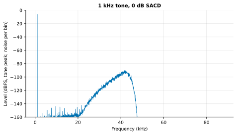
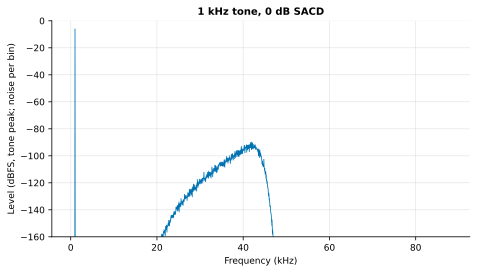
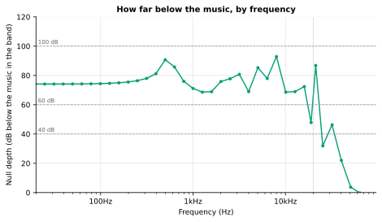

[dsd2pcm-rs](../../README.md) › [Documentation](../README.md) › [Release quality comparison](README.md) › Quality of 0.2.0 against 0.1.2

# Quality of 0.2.0 against 0.1.2

Measured with: dsd-measure 0.1.2 (commit 3eaec2d) and [suites/dsd2pcm.toml](../../suites/dsd2pcm.toml);
dsd2pcm 0.2.0 at commit e6ba8ba and 0.1.2 from tag v0.1.2 (commit 1a1c90c), both built
with Rust 1.100.0; on an AMD RYZEN AI MAX+ 395 w/ Radeon 8060S, on 2026-11-24. Changes
beyond the suite's measured run-to-run spread (any change of 0.01 dB or more; a null that
is no longer identical) are in bold.

SINAD is −THD+N of a 1 kHz tone at 0 dB SACD; THD
counts its harmonics only; the noise is unweighted from 20 Hz to 20 kHz, in dBFS referred
to a full-scale sine (the AES17-style convention); alias rejection is the level of the worst image of
the tones above the output's Nyquist frequency, in dB below the tone. The raw results are in
[data/0.2.0](data/0.2.0/README.md) (CC BY 4.0).

| Filter | Cutoff | Rate (kHz) | Version | SINAD (dB) | THD (dB) | Noise, 20 Hz-20 kHz (dBFS) | Alias rejection (dB below the tone) | Null vs previous |
|---|---|---:|---|---:|---:|---:|---:|---|
| fast | 40 | 88.2 | 0.1.2 (default) | 121.98 | -145.55 | -126.63 | 111.83 | baseline |
| fast | 40 | 88.2 | 0.2.0 | 121.98 | -145.55 | -126.63 | 111.83 | identical |
| fast | 40 | 176.4 | 0.1.2 (default) | 122.14 | -146.02 | -126.65 | 138.38 | baseline |
| fast | 40 | 176.4 | 0.2.0 | 122.14 | -146.02 | -126.65 | 138.38 | identical |
| fast | 40 | 352.8 | 0.1.2 (default) | 122.14 | -146.07 | -126.65 | not measurable | baseline |
| fast | 40 | 352.8 | 0.2.0 | 122.14 | -146.07 | -126.65 | not measurable | identical |
| fast | wide | 176.4 | 0.1.2 | 115.99 | -138.90 | -121.11 | 125.12 | baseline |
| fast | wide | 176.4 | 0.2.0 | 115.99 | -138.90 | -121.11 | 125.12 | identical |
| fast | wide | 352.8 | 0.1.2 | 116.01 | -138.98 | -121.11 | not measurable | baseline |
| fast | wide | 352.8 | 0.2.0 | 116.01 | -138.98 | -121.11 | not measurable | identical |
| pysacd | fixed | 88.2 | 0.1.2 | 127.26 | -145.51 | -130.72 | 132.57 | baseline |
| pysacd | fixed | 88.2 | 0.2.0 | **127.97** | **-146.81** | -130.72 | 132.58 | **130.2 dB** |
| pysacd | fixed | 176.4 | 0.1.2 | 127.89 | -146.55 | -130.80 | 139.49 | baseline |
| pysacd | fixed | 176.4 | 0.2.0 | **128.13** | **-147.14** | -130.80 | **139.52** | **134.6 dB** |
| precise | 40 | 88.2 | 0.2.0 (default) | **141.91** | **-160.42** | **-148.93** | **159.28** | **73.5 dB** against 0.1.2 fast |
| precise | 40 | 176.4 | 0.2.0 (default) | **143.79** | **-161.85** | **-151.45** | **165.11** | **73.5 dB** against 0.1.2 fast |
| precise | 40 | 352.8 | 0.2.0 (default) | **144.89** | **-162.58** | **-153.53** | not measurable | **73.4 dB** against 0.1.2 fast |
| precise | wide | 176.4 | 0.2.0 | **143.73** | **-162.00** | **-151.43** | **164.44** | **79.0 dB** against 0.1.2 fast |
| precise | wide | 352.8 | 0.2.0 | **145.03** | **-162.38** | **-153.58** | not measurable | **74.4 dB** against 0.1.2 fast |

"(default)" marks each version's default filter at the default cutoff, 40 (the rate is
chosen with `--rate`). The precise filter is new in 0.2.0, so its rows are measured against
the 0.1.2 default (fast) at the same cutoff and rate: a conversion with default settings changes from the
fast row to the precise row. A null depth is the music's level minus the difference's level,
from 20 Hz to 20 kHz, after dsd-measure has aligned the two outputs in time and level;
"identical" means the difference is zero to floating-point rounding.

## What changed, and why

Every change beyond the run-to-run spread is one the 0.2.0
[CHANGELOG](../../CHANGELOG.md#020---2026-11-24) lists:

- **The default is now the precise filter.** Against 0.1.2's default at the same cutoff
  and rate, SINAD is 19.93 to 22.75 dB higher with cutoff 40 (27.74 and 29.02 dB with
  wide), THD 14.87 to 16.51 dB lower (23.10 and 23.40 dB), the noise 22.30 to 26.88 dB
  lower (30.32 and 32.47 dB) and the worst alias image 26.73 and 47.45 dB further down
  (39.32 dB with wide at 176.4 kHz). The two outputs differ by 73.4 to 79.0 dB below the
  music: the filters do not have the same passband response (ripple to 20 kHz ±0.0016 to ±0.0022 dB for precise,
  ±0.0037 to ±0.0040 dB for fast, [PCM quality](../pcm-quality.md)), so their outputs are
  not expected to null. The precise figures are within what a 24-bit file allows:
  dsd-measure gives 143.7, 146.7 and 149.7 dB of SINAD for plain rounding to 24 bits at
  88.2, 176.4 and 352.8 kHz (138.9, 141.9 and 144.9 dB with TPDF dither) and reports these
  rows as "not judged" for that reason. They are the figures of the 24-bit files dsd2pcm
  writes.
- **The pysacd filter computes in f64.** SINAD rises by 0.71 dB at 88.2 kHz and 0.24 dB at
  176.4 kHz, THD falls by 1.30 and 0.59 dB, and the worst alias image is 0.008 and 0.035 dB
  further down. The noise moves by less than the table's 0.01 dB in both directions: 0.0009 dB
  lower at 88.2 kHz and 0.0006 dB higher at 176.4 kHz, in the unrounded `results.json`
  figures. The outputs differ by 130.2 and 134.6 dB below the music; dsd-measure reports that
  depth as limited by the 24-bit output of both versions.
- **The fast filter is unchanged.** Every figure is the same and every null is identical;
  the WAV files are byte-identical to 0.1.2's at every cutoff and rate in this table
  (checked with `cmp` on the multitone signal's outputs).
- **The WAV channel mask** of some multichannel layouts changes (a DSF of type 5, and
  DSDIFF files with other speaker sets); the samples do not. The suite's signals are mono,
  so this change does not reach the table.

No figure is 0.01 dB or more worse than 0.1.2's. The one figure that is worse at all is the
pysacd noise at 176.4 kHz, by 0.0006 dB, which the table's resolution does not show.

## Graphs

The default conversion at the default rate (176.4 kHz, cutoff 40), before and after: the
spectrum of the 1 kHz tone at 0 dB SACD from 0.1.2 (fast) and from 0.2.0 (precise), and the
null depth between the two by frequency. The plots are dsd-measure's, from the first run.

*0.1.2's default (fast): spurs and noise between -160 and -144 dBFS per bin below 20 kHz.*

*0.2.0's default (precise): below 20 kHz, nothing but the tone reaches the plot's -160 dBFS floor.*

*How far below the multitone the difference between the two defaults lies, by frequency.*

## Repeatability

The whole suite and the 12 null tests ran three times on the same two builds, on the same
machine and inputs. The 19 device `results.json` files and the comparison's were
byte-identical in the three runs, and each null test's figures were the same, its
`results.json` differing only in the output folder named in the command. The spread is
0.00 dB in every figure of the table, so the 0.01 dB flag of the
[comparison rules](README.md) holds for this page.

## Conclusion

Every change is one 0.2.0 intends: the precise default measures better than 0.1.2's
default in every figure, the f64 pysacd filter measures better in SINAD, THD and alias
rejection with the noise the same to 0.01 dB, and the fast filter converts exactly as
0.1.2's default did.

## See also

- [Release quality comparison](README.md): how this table is made and read
- [Raw results](data/0.2.0/README.md): the JSON files behind the table
- [PCM quality](../pcm-quality.md#the-precise-filter): the precise filter's design and
  measurements
- [User guide](../user-guide.md#choose-the-rate-and-the-filter): the filters, rates and cutoffs

Part of the [DSD Toolbox](https://github.com/dsd-toolbox/dsd-toolbox).
